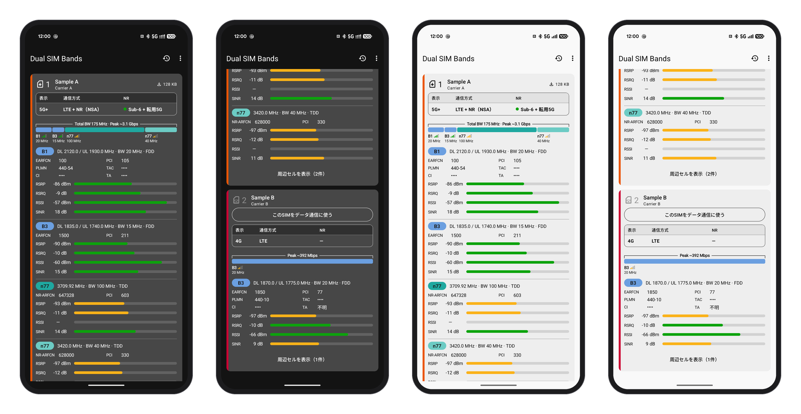

# Dual SIM Bands 1.0.0

[English](README.md)

デュアル SIM の Android 端末で、2 枚の SIM がそれぞれどのバンドにつながっているかを、バンドごとに確かめるアプリです。SIM ごとに、ステータスバーに出るキャリアの表示名を変える機能もあります。



*見本の値で表示したバンドの画面（SIM と値は作ったもの。セル ID・TAC・TA は伏せ字）。左がダークテーマ、右がライトテーマ。*

- アプリ ID：`io.github.fortuneoflab.dualsimbands`
- 対応：Android 12（API 31）以降。root は不要です。
- 確認した端末：Google Pixel 10a（Android 17）。回線は IIJmio（KDDI 回線の SIM と docomo 回線の eSIM）、docomo 回線の eSIM、povo（KDDI 回線）、LINEMO（SoftBank 回線）のうち 2 枚ずつ。
- 表示言語：日本語と英語（日本語の端末では日本語、それ以外は英語。Android の設定でアプリごとに変更できます）
- 一部の機能は [Shizuku](https://shizuku.rikka.app/) を使います（後述）。

## できること

アプリを開くとバンドの画面が出ます。右上の履歴のアイコンで履歴の画面を、右上の ⋮ から「ステータスバーのカスタマイズ」「設定」「表記の意味」「このアプリについて」を開きます。⋮ の「セルID・TAC・TAを伏せる」で、画面のセル ID・TAC・TA を「••••」で伏せる／表示するを切り替えられます（スクリーンショット用。既定は伏せる）。開いた画面は左上の ← で戻ります。

### バンドの画面
SIM ごとにカードを出します。カードの左端には SIM の色の帯が付き、見出しには eSIM か物理 SIM かを添えます。見出しは、SIM の番号を SIM の絵と一緒に大きく出し、その右に設定アプリの SIM のラベルと、その下に Android が報告するキャリア名を出します（2つが同じ名前なら1つだけ）。色は設定の「SIMの色」で選べます（回線から判定：MCC-MNC で回線の会社ごとの色。MVNO やサブブランドは親回線の色。Androidの設定：設定アプリの SIM の色）。

- **状態の表**：表示（4G / 4G+ / 5G / 5G+）、通信方式（LTE、LTE + NR（NSA）、NR（SA））、NR（Sub-6・転用5G・ミリ波・待受中・未確認・—。複数の種類を束ねているときは「Sub-6 + 転用5G」のように並べる）
- **帯域幅のバー**：使っているキャリアを帯域幅の比率で並べます（PCC → LTE の SCC → NR の順）。色は LTE が青、NR は周波数の種類で、転用5G が緑、Sub-6 が橙、ミリ波が赤紫です（バンドの印と周辺セルの一覧も同じ色）。
  データ通信中で構成（PhysicalChannelConfig）が分かり、すべての帯域幅が報告されたときは、バーの上に下りの最大速度の推定（「Peak」。日本語表示でも英語で「Total BW 120 MHz · Peak ~2.1 Gbps」のように出します）を出します。推定であることと仮定は「表記の意味」に載せています。キャリアが 2 本以上なら合計の帯域幅も並べます。理論値は端末から分からない値を仮定した計算です（256QAM、1 GHz 以上は 4×4 MIMO（ミリ波を除く）・1 GHz 未満とミリ波は 2×2、NR のサブキャリア間隔は TDD 30 kHz・FDD 15 kHz・ミリ波 120 kHz、TDD は時間の 75% を下りとみなす。LTE は 20 MHz・4 層の最大値をリソースブロック数と層数で比例配分した近似）。規格の表から求めた厳密な値ではありません。実際の速度は多くの場合その一部です。
- **バンドごとのブロック**：バンド、DL / UL の周波数、帯域幅、EARFCN / NR-ARFCN、PCI、FDD / TDD、PLMN・TAC・セル ID・TA（報告された値のまま。距離には換算しません）、RSRP・RSRQ・RSSI・SINR のメーター
- **周辺セル**：つながっていない隣のセルを、電波の強い順に表で出します。
- **SIM の操作**：データ通信に使っていない SIM のカードには「このSIMをデータ通信に使う」ボタンがあります。設定の「アプリ内でデータ通信SIMを切り替える」と Shizuku があればアプリの中で切り替え、なければ Android の SIM の設定を開きます。SIM を使う・止める・入れ替える操作や、通話・SMS に使う SIM の選択は、画面右上の ⋮ の「AndroidのSIM設定」から Android の設定で行います（このアプリでは行いません）。使っている SIM がないときは、画面に「SIMの設定を開く」を出します。

データ通信用でない SIM や、通信していないデータ SIM は「待ち受け」とみなします。前回の通信の名残（4G+ の表示や帯域幅の一覧）は使いません。

### ステータスバーのカスタマイズ（⋮ から）
ステータスバーなどに出るキャリア名と 4G／5G の表示を変えます（Shizuku が必要）。

- **ステータスバー**（使っているすべての SIM に当てます）：キャリア名を常に表示、Wi-Fi 中も 4G／5G を常に表示、4G+ を表示（Android の既定では LTE で束ねていても「4G」と出ます）
- **自動復元**：再起動後も設定を保つ（再起動や SIM の切り替えで元に戻った表示を、Shizuku の起動後に自動でこの画面の設定に戻す）
- **キャリア表示**（SIM ごとの表示名）：表示名は回線ごとに保存し、SIM の差し口が変わっても eSIM を切り替えても、同じ回線なら同じ名前で表示します。オフにして保存すると変更前の名前に戻します。今使っていない回線の名前も編集できます。
- Android の設定アプリと同じく、スイッチは切り替えた時点で、表示名は SIM の行を押して開く画面で保存した時点で、すぐに適用します。書き込んだあとは設定値を読み戻して確認します。
- 再起動のあとや、SIM の組み合わせが変わったとき（Android の設定で SIM を切り替えたときなど）、保存した設定を自動で当て直します。
- 「このアプリの変更前の値へ戻す」で、すべてを元に戻せます。

### 履歴
電波の状態を端末内に記録し、CSV に書き出せます。外部へは送信しません。「履歴の記録」で、オフ（最初）か、記録する時間（15分・30分・1時間・2時間・4時間・8時間・12時間・24時間）を選びます。時間を選ぶと記録が始まり、その時間で自動で止まります。記録は常駐通知を使い、ロックしたまま持ち歩いても続けます（電池を使います）。常駐通知の「停止」か、履歴の画面でもう一度押すと、途中で止められます。画面オフの間は Android が電波の強さの知らせを止めるので、強さ（RSRP など）は、約10秒ごとに取り直すつながっているセルの測定値で記録します。

### 設定（⋮ から）
権限と Shizuku の状態、表示の設定、常駐通知、通信の発生、実験的な機能をまとめています。Android の設定アプリと同じ並べ方で、注意事項は画面の一番下にまとめています。

## Shizuku なしで使う場合（基本モード）

Shizuku が入っていない、または起動していないときは、自動で基本モードになります。バンドの画面（各 SIM のバンド・帯域幅・信号・周辺セル）と履歴は、Android の公開 API だけでそのまま使えます。構成（PCC・SCC）は Android のセル一覧から組み立てます。ステータスバーのカスタマイズは案内だけを出し、設定の実験的な機能は隠れます。Shizuku を起動して許可すると、すぐにすべての機能が使えるようになります。

## Shizuku で使う機能

Shizuku は、パソコンなしで Android の開発者向けの権限（shell の権限）をアプリに貸すツールです。root とは違い、システムの権限は得られません。

| 機能 | 内容 |
|---|---|
| SIM の表示名 | キャリアの設定を一時的に書き換えます（再起動で元に戻るため、起動後に自動で戻します）。 |
| キャリア構成の取得（設定で選ぶ） | 各キャリアの役割（PCC/SCC）・帯域幅・バンド（PhysicalChannelConfig）を読みます。設定の「キャリア構成（PCC/SCC）の取得」で、「取得しない」「ボタンを押したときだけ」「自動」（バンドの画面を開いている間と、履歴を記録している間）から選びます。 |
| データ通信SIMの切り替え（設定でオン） | アプリの中からデータ通信用の SIM を切り替え、前の SIM のモバイルデータのオン・オフを引き継ぎます。 |

キャリア構成の取得とデータ通信 SIM の切り替えは、Android の内部の仕組みを使う実験的な機能です。Android の更新で動かなくなることがあります。

## インストール

1. 配布された APK を端末に入れます。PC からは次のようにします（`adb` は Android SDK Platform-Tools）。
   ```powershell
   adb install DualSIMBands-1.0.0.apk
   ```
2. 端末のアプリ一覧に「Dual SIM Bands」が追加されます。

## 初回設定

1. Shizuku を起動します（Shizuku のアプリの案内に従い、ワイヤレスデバッグなどで起動します）。
2. Dual SIM Bands を開き、右上の ⋮ →「設定」の「権限」を押して、電話・位置情報・通知を許可します。続けて Shizuku の許可を求められたら許可します。
   - 電話：SIM の情報を読むため（発信や電話番号の取得はしません）
   - 位置情報：セル一覧（バンド・PCI・周辺セル）を読むため。履歴で位置の記録をオンにしたときだけ、端末内の履歴に記録します（送信はしません）
   - 通知：常駐通知と、表示名を戻したときのお知らせのため
   - 最後に Shizuku の使用の許可を求められます。
3. バンドの画面で、各 SIM のバンドが表示されることを確かめます。
4. 表示名を変える場合は、⋮ →「ステータスバーのカスタマイズ」の「キャリア表示」で SIM の行を押し、名前を入れて「保存」を押します。

## 再起動したあと

root なしの Shizuku は、再起動すると止まります。Shizuku を起動し直すと、「Shizuku起動後に自動復元」がオンなら、保存した表示名を自動で戻します。

Shizuku を起動し直したのにアプリが「Shizuku 停止中」のままのとき（常駐通知の「Shizuku 未接続」も同じ）は、Shizuku が動いていることを確かめ、ホームに戻ってから Dual SIM Bands を開き直してください。開いたままでは、つながり直さないことがあります。

## 表示名で書き換える設定

| 設定 | 名前を指定しない | 名前を指定する |
|---|---|---|
| `show_operator_name_in_statusbar_bool` | `true` | `true` |
| `carrier_name_string` | 空文字 | 指定した名前 |
| `carrier_name_override_bool` | `false` | `true` |
| `enable_carrier_display_name_resolver_bool` | `false` | `true` |
| `spn_display_condition_override_int` | `-1` | `2` |
| `always_show_data_rat_icon_bool` | 「Wi-Fi中も4G／5Gを表示」の選択 | 同左 |

キャリアの設定は一時的な上書き（再起動で消える形）で書き込みます。両方の SIM に共通の設定 `show_operator_name`（Secure Settings）は `1` にします。APN、VoLTE、5G、バンド、ネットワーク選択の設定は変えません。

「このアプリの変更前の値へ戻す」で、再起動後にこのアプリが最初に変更する前の値に戻せます（表示名の上書きは再起動で消えるため、変更前の値も起動ごとに記録し直します）。以前の版で記録した変更前の値は、いつ記録したか分からないため使いません。更新後に一度再起動してから適用してください。端末の起動回数を読み取れないときは、適用も復元もしません。アプリを削除するだけでは元に戻らないので、先にこの操作をしてください。

## 通信とプライバシー

- 端末の情報を外部へ送ることはありません。
- **通信の発生**（設定、最初はオフ）をオンにしたときだけ、バンドの画面を開いている間と、履歴を記録している間（画面を閉じても消しても）、データ通信用 SIM のモバイル回線で速度測定用サーバー（speed.cloudflare.com）から、設定の「通信の間隔」（2秒・10秒・30秒・60秒、最初は2秒）ごとに 1 KB のデータを受け取ります（接続の手続きなどを含めると1回 約3 KB。1時間あたり 2秒で約5 MB、10秒で約1 MB、30秒で約0.4 MB、60秒で約0.2 MB。2秒のときに測った値からの目安）。4G+ や 5G+ の状態を作るための機能で、データ通信量と電池を使います。画面に出る量は、今のデータ通信用 SIM で受け取った分です（データ通信用 SIM を替えると 0 から数え直します）。間隔が短いほど短い詰まりも記録できますが、モデムが休めないため電池を多く使います（Pixel 10a で2秒のとき、画面オフ・電池の17時間42分で 3,425 mAh を使い、無線が動いていた時間は74%。データ量は1時間あたり約 4.5 MB）。
- 記録中に通信を発生させているときは、データ通信用 SIM の行に、前の行からの応答の回数（traffic_ok）・タイムアウト（traffic_timeouts）・そのほかの失敗（traffic_errors）・最初の応答までの最大の時間（traffic_latency_ms_max）・失敗が続いている秒数（traffic_failing_s。失敗していなければ 0、失敗中は切り上げて 1 以上）・Android がインターネットへの接続を確かめたか（net_validated）を記録します。応答がないのは電波のほかサーバーや DNS が原因のこともあるので、「パケ詰まり」とは書かず、測った事実だけを記録します。もう一方の SIM の行と、通信していない行は not_recorded です。画面オフ・電池のときは、通信していても Android はキャリア構成の知らせを止めます（Pixel 10a で確認）。そのため、キャリア構成の取得が「自動」のときは、記録している間だけ Android の設定 nr_nsa_tracking_screen_off_mode を Shizuku で 2 にし（画面オフでも知らせが届く。電池を使います）、記録が終わったら元の値に戻します。記録の途中でほかの方法で値が変わっていたら、戻しません。Shizuku が使えないときは書き換えず、戻せなかったときは次に Shizuku がつながったときに戻します。知らせが届かない間（画面オフ・電池で、この設定が 2 でないとき）の構成は、時間がたつと確認済みではなくなります。代わりにセルの一覧が「つながっている」と示すセルを記録しますが、一覧にはキャリアが一部しか出ないことがあるため（Pixel 10a で、n77 が2つのところ1つだけ出た）、種類ごとに1つずつしか出ていないときは CA かどうかを決めません（ca_status は CELLS_ONLY）。
- 履歴の CSV は schema_version 1 です。
- セル ID・TAC は、事業者の番号と合わせると基地局を特定でき位置の推定につながるため、履歴への記録は、設定「セルID・TAC・TAも記録する」をオンにしたときだけです（TA は報告された値のまま）。使用中のセルの PCI・TAC・セル ID・TA は、セルの一覧が新しいときだけ記録し、古いとき（cells_stale が true）は unknown にします。新しさはセルごとの測定時刻で判断し、使用中のセル自身が30秒より古ければ記録しません（測定時刻を報告しないセルは、届いた時刻を測定時刻とみなします）。位置（緯度・経度）は、別の設定「位置（緯度・経度）も記録する」（最初はオフ）をオンにしたときだけ、履歴を記録している間に GPS で取り、精度と取得からの秒数と一緒に記録します。移動中は 50 m ごとにも記録します。移動の記録そのものなので、CSV の共有に注意してください。CSV には、確認できたキャリアごとのバンド・帯域幅・PCI・信号（ca_detail、JSON）も入ります。画面では、設定「セルID・TAC・TAを表示」がオフのとき（既定）、セル ID・TAC と TA（基地局からの距離の手がかり）を「••••」で伏せます。項目の並びは変わらないので、これらの値を伏せた状態でスクリーンショットを共有できます。伏せるのは画面の表示だけで、履歴の記録と CSV の書き出しには影響しません。PLMN・PCI・EARFCN や周辺セルの構成は伏せないため、場所が推測できないことまでは保証しません。バンドの画面の右上の ⋮ にある「セルID・TAC・TAを伏せる」でも切り替えられます。PCI と EARFCN は近くの基地局や地域で使い回す番号なので、常に表示・記録します。

## 分かっている制約

- キャリア構成（PCC・SCC）は、取得できるときに確かめられます。取れないときは、Android の表示などの手がかりから「未確認」として出します。
- 5G の表示は、NR で通信している証明ではありません。NR につながっていることを確かめられたときだけ「Sub-6」などを緑の点で出します。
- Pixel 10a では、NR の SINR と RSSI、SCC の PLMN・TAC・セル ID・TA は Android から報告されません。SCC の RSSI は RSRP・RSRQ・帯域幅から計算し、「≈」を付けて出します。
- Shizuku 経由で取得した構成では PCI が伏せられるため、PCI はこのアプリのセル一覧から補います。
- 常駐通知は、履歴を記録していて、キャリア構成の取得が「自動」のときだけキャリア構成を取得します。それ以外は取得しないため、NR は「未確認」になりやすくなります。

## ビルド

JDK 17 以上と Android SDK Platform 36 が必要です。プロジェクト直下で実行します。

```powershell
.\gradlew.bat :app:testDebugUnitTest :app:lintDebug :app:assembleDebug
```

- **debug ビルド**は、Android SDK が PC ごとに作る開発用の鍵（`~/.android/debug.keystore`）で署名します。リポジトリには鍵を含めません。
- **release ビルド**（`:app:assembleRelease`）は公開用の鍵で署名します。鍵はリポジトリに含めません。`keystore.properties.example` を `keystore.properties` にコピーして、鍵のファイルの場所とパスワードを書いてください（このファイルは git の対象外です）。無いときの release ビルドは署名なしになります。
- 開発用の鍵と公開用の鍵で署名した版は、互いに上書きインストールできません。別の PC でビルドした debug 版どうしも、鍵が違うため上書きできません。

公開用の鍵の証明書：`CN=FortuneOfLab`、SHA-256 `cef3b2eaf4dc4ee76e90504e3214c81f931272a96f8f97de53bf67e4bf503c74`

## ライセンスと参考

このアプリは MIT ライセンスです（`LICENSE`）。使っているライブラリとライセンスは `THIRD_PARTY.md` と `licenses/` にあります。このアプリの開発中の記録（調査・計画・各機能の確認結果）は `docs/` にあります。
