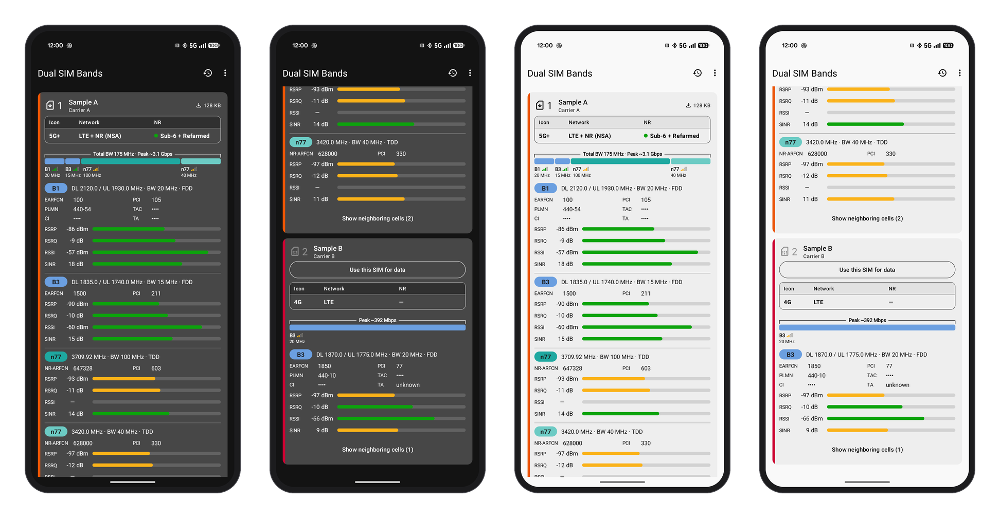

# Dual SIM Bands 1.0.0

[日本語](README-ja.md)

An Android app for dual-SIM phones that shows, band by band, which bands each of the two SIMs is connected to. It can also change the carrier name shown in the status bar for each SIM.



*The bands screen with sample data (made-up SIMs and values; cell ID, TAC and TA masked). Dark theme on the left, light on the right.*

- App ID: `io.github.fortuneoflab.dualsimbands`
- Requires Android 12 (API 31) or later. No root needed.
- Tested on: Google Pixel 10a (Android 17), two at a time of: IIJmio (a SIM on the KDDI network and an eSIM on the docomo network), an eSIM on the docomo network, povo (KDDI network) and LINEMO (SoftBank network).
- Languages: English and Japanese (Japanese on Japanese devices, English everywhere else; can be changed per app in Android's settings)
- Some features use [Shizuku](https://shizuku.rikka.app/) (see below).

## Features

The app opens on the bands screen. The history icon at the top right opens History; the ⋮ menu next to it opens Customize status bar, Settings, Terms and About. **Mask cell ID, TAC and TA** in the same menu masks them on screen as •••• or shows them (for screenshots; masked by default). Each opens over the bands screen; the ← at the top left goes back.

### Bands screen
One card per SIM, with a color stripe down its left edge and eSIM or Physical SIM after the title. The header shows the SIM number large with the SIM icon, and beside it the SIM label from Android's Settings app over the carrier name reported by Android (once, when the two are the same). The color is chosen under "SIM color" in Settings: *From network* (a color per carrier from the MCC-MNC; MVNOs and sub-brands get their host network's color) or *From Android settings* (the SIM color set in Android's Settings app).

- **State table**: icon (4G / 4G+ / 5G / 5G+), network (LTE, LTE + NR (NSA), NR (SA)) and NR (Sub-6, Refarmed, mmWave, Standby, Unconfirmed, —; several classes in use are listed together, such as "Sub-6 + Refarmed")
- **Bandwidth bar**: the carriers in use, sized by bandwidth (PCC, then LTE SCCs, then NR). LTE is blue; NR is colored by frequency class: refarmed green, Sub-6 orange, mmWave magenta (the band badges and the neighboring cells use the same colors).
  When data is active, the composition (PhysicalChannelConfig) is known and every bandwidth is reported, a bracket above the bar shows an estimated downlink peak ("Peak"), plus the total bandwidth when there are two or more carriers. The peak is an estimate that assumes values the device does not report (256QAM; 4×4 MIMO at 1 GHz and above except mmWave, 2×2 below and for mmWave; NR subcarrier spacing 30 kHz for TDD and 15 kHz for FDD, 120 kHz for mmWave; 75% of TDD time on the downlink; LTE scales the 20 MHz, 4-layer peak by resource blocks and layers, an approximation). It is not an exact figure from the standards tables. Real speeds are usually a fraction of it. The assumptions are listed under Terms.
- **Per-band blocks**: band, DL / UL frequency, bandwidth, FDD / TDD, EARFCN / NR-ARFCN, PCI, PLMN, TAC, cell ID and TA (as reported, not converted to a distance), and RSRP, RSRQ, RSSI and SINR meters
- **Neighboring cells**: cells that are measured but not connected, strongest first.
- **SIM actions**: a card of a SIM not used for data has a Use this SIM for data button. It switches in the app with the setting "Switch data SIM in the app" and Shizuku, and otherwise opens Android's SIM settings. SIMs are turned on, off and swapped, and the SIMs for calls and SMS chosen, in Android's settings, opened with Android SIM settings in the ⋮ at the top right (this app does none of that). With no SIM in use, the screen shows Open SIM settings.

A SIM that is not the data SIM, or a data SIM with no traffic, is treated as standby: leftovers from the last connection (a 4G+ icon or a bandwidth list) are not used.

### Customize status bar (from ⋮)
Changes the carrier name and the 4G/5G icon shown in the status bar and elsewhere (requires Shizuku).

- **Status bar** (applied to every SIM in use): always show the carrier name, always show 4G/5G on Wi-Fi, show 4G+ (by Android's default, aggregated LTE still shows as 4G)
- **Automatic restore**: keep settings after a reboot (after a reboot or a SIM change, the display is put back to these settings once Shizuku starts)
- **Carrier display** (a name for each SIM): names are saved per line, so the same line keeps its name in any SIM slot and after switching eSIMs. Turn a name off and save to go back to the original. Names of lines not in use can be edited too.
- As in Android's Settings app, a switch applies as soon as it is flipped, and a name as soon as it is saved in the dialog that opens from its SIM row. Values are read back after writing to confirm them.
- After a reboot, and when the set of SIMs in use changes (such as when SIMs are switched in Android's settings), the saved settings are applied again automatically.
- Restore original values puts everything back.

### History
Records the radio state on the device and exports it as CSV. Nothing is sent anywhere. **Record history** offers Off (at first) or a time to record for (15 or 30 minutes, 1, 2, 4, 8, 12 or 24 hours). Choosing a time starts recording, and it stops by itself at that time. Recording uses the ongoing notification and goes on while the phone is locked in a pocket (this uses battery). Stop in the ongoing notification, or tapping it again on the history screen, stops it early. With the screen off, Android stops signal-strength reports, so the signal (RSRP and so on) is recorded from the serving cell's measurements, read again about every 10 seconds.

### Settings (from ⋮)
Permissions and Shizuku status, display options, the ongoing notification, traffic generation and experimental features, laid out like Android's own Settings app with the notes at the bottom of the page.

## Without Shizuku (basic mode)

When Shizuku is not installed or not running, the app switches to basic mode by itself. The bands screen (each SIM's bands, bandwidths, signal and neighboring cells) and History work with Android's public APIs alone; the composition (PCC and SCC) is built from Android's cell list. Customize status bar shows only a short guide, and the experimental settings are hidden. Once Shizuku is started and allowed, everything is available again.

## What Shizuku is used for

Shizuku lends an app Android's developer (shell) permissions without a PC. Unlike root, it does not give system privileges.

| Feature | What it does |
|---|---|
| Carrier names | Temporarily overrides carrier configuration (a reboot clears it, so it is restored after start-up). |
| Reading the carrier composition (choose in Settings) | Reads each carrier's role (PCC/SCC), bandwidth and band (PhysicalChannelConfig). **Carrier composition (PCC/SCC)** in Settings offers Don't read, Only with the Read button, and Automatic (while the bands screen is open, and while history is recorded). |
| Switching the data SIM (enable in Settings) | Switches the data SIM from inside the app, carrying the previous SIM's mobile data on or off over. |

Reading the carrier composition and switching the data SIM are experimental: they use Android internals and may stop working after an Android update.

## Install

1. Install the APK on the phone. From a PC (`adb` is in Android SDK Platform-Tools):
   ```powershell
   adb install DualSIMBands-1.0.0.apk
   ```
2. "Dual SIM Bands" appears in the app list.

## First setup

1. Start Shizuku (follow the Shizuku app's instructions, for example with wireless debugging).
2. Open Dual SIM Bands, tap **Permissions** in ⋮ > **Settings** and allow phone, location and notifications; then allow Shizuku when asked.
   - Phone: to read SIM information (the app does not make calls or read phone numbers)
   - Location: to read the cell list (bands, PCI, neighboring cells); recorded in the on-device history only when location recording is on in History, and never sent
   - Notifications: for the ongoing notification and the restore notice
3. Check that each SIM's bands appear on the bands screen.
4. To change carrier names, open ⋮ > **Customize status bar**, tap the SIM under Carrier display, enter a name and tap Save.

## After a reboot

Shizuku without root stops on reboot. When it is started again and "Restore automatically when Shizuku starts" is on, the saved names are restored automatically.

If the app still says Shizuku is not running after it was started (or the ongoing notification says Shizuku not connected), check that Shizuku is running, go to Home and reopen Dual SIM Bands. While the app stays open, it may not reconnect.

## Settings written for carrier names

| Setting | No name set | Name set |
|---|---|---|
| `show_operator_name_in_statusbar_bool` | `true` | `true` |
| `carrier_name_string` | empty | the name |
| `carrier_name_override_bool` | `false` | `true` |
| `enable_carrier_display_name_resolver_bool` | `false` | `true` |
| `spn_display_condition_override_int` | `-1` | `2` |
| `always_show_data_rat_icon_bool` | the "Show 4G/5G icon on Wi-Fi" choice | same |

Carrier configuration is written as a temporary override (cleared by a reboot). The setting shared by both SIMs, `show_operator_name` (Secure Settings), is set to `1`. APN, VoLTE, 5G, band and network selection settings are not changed.

"Restore original values" returns to the values from before this app first changed them after the last reboot (overrides are cleared by a reboot, so the original values are recorded again in every boot). Values recorded by earlier versions are not used, because when they were recorded is unknown: reboot once after updating, then apply. If the boot count cannot be read, nothing is applied or restored. Uninstalling alone does not undo the change, so restore first.

## Network use and privacy

- No device information is sent anywhere.
- Only when **Generate traffic** (Settings, off by default) is on, while the bands screen is open and while history is recorded (also with the screen closed or off), the app downloads 1 KB at the **Traffic interval** (2, 10, 30 or 60 seconds; 2 at first) from a speed-test server (speed.cloudflare.com) over the data SIM's mobile network (about 3 KB each time with the connection set-up; an hour, about 5 MB at 2 s, 1 MB at 10 s, 0.4 MB at 30 s and 0.2 MB at 60 s, estimated from a measurement at 2 s). It exists to bring up 4G+ / 5G+ and uses mobile data and battery. The amount shown is what the data SIM in use has received (it counts again from 0 when the data SIM changes). A shorter interval catches shorter stalls but keeps the modem from resting, so it uses more battery (on the Pixel 10a at 2 seconds: 3,425 mAh in 17 h 42 min on battery with the screen off, the radio active 74% of the time, about 4.5 MB of data an hour).
- While traffic is generated during recording, the data SIM's rows record, since the previous row, the requests answered (traffic_ok), timed out (traffic_timeouts) and failed otherwise (traffic_errors), the slowest time to the first byte (traffic_latency_ms_max), how long requests have kept failing (traffic_failing_s: 0 when not failing, otherwise rounded up and at least 1) and whether Android validated internet access (net_validated). A missing answer may come from the server or DNS as well as the radio, so only these measurements are recorded, nothing is called a stall. The other SIM's rows and rows without traffic say not_recorded. With the screen off on battery, Android stops channel-configuration reports even while traffic flows (checked on the Pixel 10a). So with the carrier composition set to Automatic, Android's setting nr_nsa_tracking_screen_off_mode is set to 2 through Shizuku while recording (the reports then go on with the screen off; this uses battery) and put back to its earlier value when recording ends. A value changed another way meanwhile is left alone. Without Shizuku nothing is written, and an undo that could not run is done the next time Shizuku connects. While no reports come (screen off on battery, the setting not 2), the composition stops counting as verified after a while. The cells the cell list marks as serving are recorded instead; that list may leave carriers out (on the Pixel 10a it showed one n77 where there were two), so with one cell per RAT there CA is left open (ca_status CELLS_ONLY).
- History CSV files are schema_version 1.
- Cell ID and TAC, with the network code, identify one cell and can reveal a location, so they are recorded only when **Also record cell ID, TAC and TA** is on (TA as reported). The serving cell's PCI, TAC, cell ID and TA are recorded only from a current cell list; with a stale one (cells_stale true) they are unknown. Freshness is judged by each cell's own measurement time, and a serving cell older than 30 seconds is not recorded (a cell reported without a time is taken as measured when it arrived). Location (latitude and longitude) is recorded only when the separate **Also record location** setting is on (off at first): it is taken by GPS while history is being recorded, with its accuracy and age, and a row is also recorded every 50 m while moving. It is a record of where you went, so take care when sharing the CSV. The CSV also holds each verified carrier's band, bandwidth, PCI and signal (ca_detail, as JSON). On screen, while **Show cell ID, TAC and TA** is off (the default), cell ID, TAC and TA (a clue to the distance from the cell) are masked as ••••; the layout stays the same, so a screenshot can be shared with these values hidden. Masking applies to the screen only, not to recorded history or the CSV export. PLMN, PCI, EARFCN and the neighboring cells stay visible, so it does not guarantee that a location cannot be guessed. **Mask cell ID, TAC and TA** in the ⋮ menu of the bands screen switches it too. PCI and EARFCN are reused among cells and areas, so they are always shown and recorded.

## Known limitations

- The carrier composition (PCC and SCC) is confirmed only when it can be read. Otherwise, hints such as Android's display are shown as "Unconfirmed".
- A 5G icon is not proof of an NR connection. "Sub-6" and the like appear with a green dot only when NR is confirmed.
- On the Pixel 10a, Android does not report NR SINR and RSSI, or the PLMN, TAC, cell ID and TA of SCCs. SCC RSSI is calculated from RSRP, RSRQ and bandwidth and marked with "≈".
- The carrier composition read through Shizuku has PCI masked, so PCI comes from this app's own cell list.
- The ongoing notification reads the carrier composition only while history is recorded and the carrier composition is set to Automatic. Otherwise it does not, so NR tends to show as Unconfirmed.

## Build

Needs JDK 17 or later and Android SDK Platform 36. Run from the project root:

```powershell
.\gradlew.bat :app:testDebugUnitTest :app:lintDebug :app:assembleDebug
```

- **Debug builds** are signed with the debug key the Android SDK creates on each computer (`~/.android/debug.keystore`); no key is kept in the repository.
- **Release builds** (`:app:assembleRelease`) are signed with the release key, which is not in the repository. Copy `keystore.properties.example` to `keystore.properties` and fill in the keystore path and passwords (the file is ignored by git). Without it the release build is unsigned.
- Builds signed with a debug key and with the release key cannot be installed over each other; neither can debug builds made on different computers.

Release certificate: `CN=FortuneOfLab`, SHA-256 `cef3b2eaf4dc4ee76e90504e3214c81f931272a96f8f97de53bf67e4bf503c74`

## License

MIT (`LICENSE`). Libraries and their licenses are listed in `THIRD_PARTY.md` and `licenses/`. Development notes (investigation, plans and verification) are in `docs/` (Japanese).
